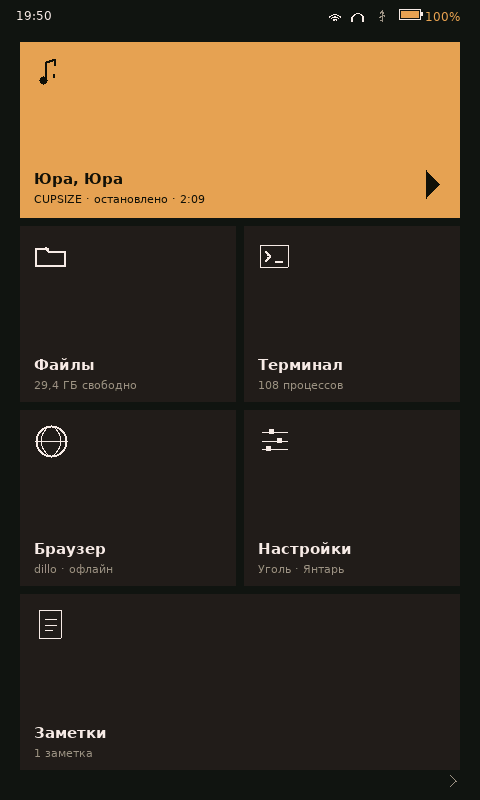
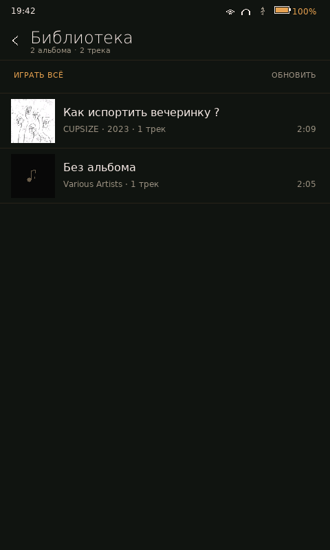
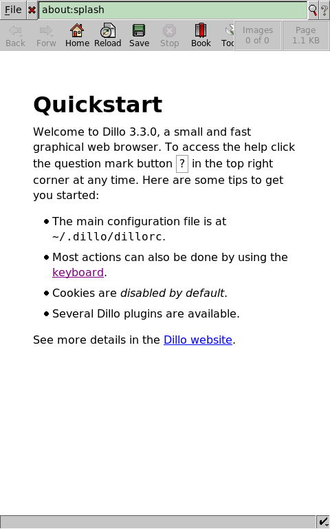

[RU](README.md) | [**English**](README.en.md)

# graphite shell — a Linux shell for the LG Optimus L7

Graphite shell is a full-screen Xlib interface for the LG Optimus L7 running Linux. The idea is to give an old phone a small, practical job: play music, browse files and notes, and see how much interface fits into a 480×800 display and 512 MB of RAM.

This is not a claim to have built a complete operating system, nor a way to turn the phone into a modern smartphone. The shell runs on the device, but it is still a prototype: some system features are unfinished, and a full release-level test cycle remains to be done.

## A few screens


*Home: tiles and shortcuts.*


*The library for the MPD player.*


*Dillo running in an external window hosted by the shell. It won't make this phone a powerhouse for browsing, though.*

## Hardware

- LG Optimus L7 P700/P705, Qualcomm MSM7227A.
- The test unit is a **P705** (`u0`); its stock `p14` carries a P700-compatible SlimKat, so `build.prop` may report P700.
- 480×800 display, 16-bit RGB565.
- 512 MB RAM and 4 GB eMMC.
- Alpine Linux / postmarketOS on the archived downstream 3.4 kernel.

The P705 is close to the P700, but differs in its NFC configuration. A component being listed in the hardware specs does not mean it is supported by the system.

## What works

At the center is a full-screen Xlib shell, with no window manager. Alongside home, player, library, queue, settings, apps, files, notes, terminal and browser, it has a task screen (two external-app slots; long-press Home opens it), a notification shade, PIN lock, a reader for TXT/FB2/FB2.zip/EPUB 2/3, a PNG/JPEG viewer, and clock and timer screens. Wide photos are displayed in landscape in the viewer. Files can be opened from Files in the matching reader or image viewer.

Touch, physical keys and basic gestures work. Wi-Fi, audio and headphones, the SD card, battery indication and screenshots have worked on the tested setup. Results depend on the image and the individual phone; a host preview is no substitute for testing on the device.

## What does not (yet)

Telephony (SIM and calls), camera, video, GPU acceleration, Bluetooth and GPS are not implemented. Suspend is not used; a safe suspend mode has not been verified. Background work by external apps is limited. The PIN is an access barrier, not encryption. The shade shows up to three cards and `+N`, but does not keep persistent history. The viewer and clock/timer have passed host tests but have not yet been run on the phone.

## Installation

The postmarketOS port is archived and based on a downstream 3.4 kernel. Installation is experimental: an unlocked bootloader, V20 baseband and a ZIP-capable recovery are required (the verified unit runs ClockworkMod 6.0.3.2). It can erase data or leave the phone unable to boot. Read the [full guide](docs/en/install.md) or the [Russian guide](docs/ru/install.md) first, and have a recovery path ready.

The recovery workflow has been tested on the test unit, including a nandroid rollback; this is not a public recovery release or a guarantee for other device revisions.

## Build and run

The shell is built with `-O2`. On a configured Alpine/postmarketOS device:

```sh
cd os && ./build.sh
```

For a host build and preview, you will need Xvfb:

```sh
cd os
sh host-build.sh && sh preview.sh home
```

See [`os/README.md`](os/README.md) for dependencies, running the shell and more build details.

## Repository layout

- `os/` — the C++ shell, build and run scripts.
- `shell/` — HTML/CSS/JS mock-ups and themes.
- `docs/ru/` and `docs/en/` — technical documentation.
- `docs/assets/` — interface screenshots.

## Documentation

- [Russian documentation index](docs/ru/index.md)
- [English documentation index](docs/en/index.md)

Some notes are still working engineering drafts, and a few links may point to files from the original working tree that are not included here.

## Licenses

Code is MIT-licensed. The Medeo font is under SIL OFL 1.1, DejaVu has its own license, and Phosphor icons are MIT-licensed. See [`THIRD-PARTY.md`](THIRD-PARTY.md) for details and license texts.
