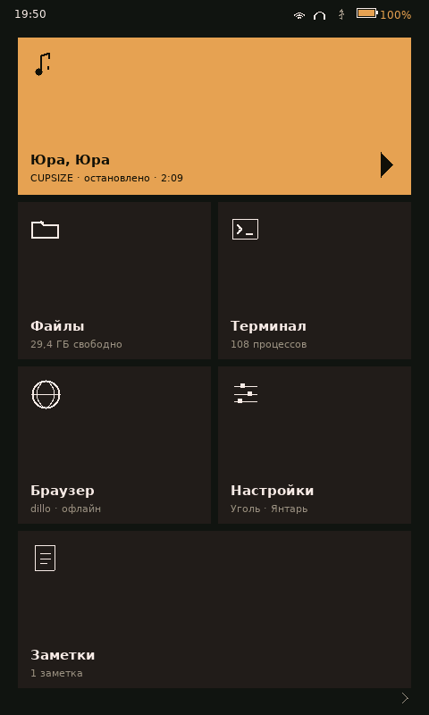
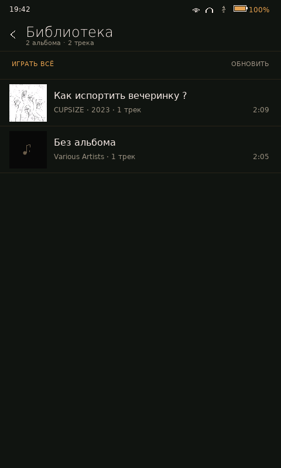
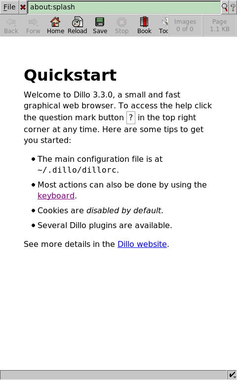

[**Русский**](README.md) | [English](README.en.md)

# graphite shell — оболочка для LG Optimus L7

Graphite shell — полноэкранная Linux-оболочка на Xlib для LG Optimus L7. Это способ дать старому телефону небольшую, понятную работу: запускать музыку, открывать файлы и заметки, а заодно проверять, сколько интерфейса помещается в 480×800 и 512 МБ памяти.

Здесь нет попытки выдать оболочку за полноценную ОС или превратить телефон в современный смартфон. Проект работает на устройстве, но остаётся прототипом: часть системных возможностей не готова, а полный релизный цикл проверки ещё впереди.

## Несколько экранов


*Пуск: плитки и быстрые переходы.*


*Библиотека для плеера на MPD.*


*Внешнее окно Dillo внутри оболочки. Тяжёлый браузер из этого телефона всё равно не получится.*

## Железо

- LG Optimus L7 P700/P705, Qualcomm MSM7227A.
- Экран 480×800, 16 бит, RGB565.
- 512 МБ RAM и eMMC 4 ГБ.
- Alpine Linux / postmarketOS на архивном downstream-ядре 3.4.

P705 близок к P700, но отличается конфигурацией NFC. Наличие компонента в характеристиках не означает, что он поддержан в системе.

## Что работает

В основе — один полноэкранный shell на Xlib, без оконного менеджера. Есть экраны home, player, library, queue, settings, apps, files, notes, terminal, browser, shade и lock; доступны темы и системные настройки.

Работают тач, физические клавиши и базовые жесты. На проверенной конфигурации работали Wi-Fi, звук и наушники, SD-карта, индикация батареи и снятие скриншотов. Результаты зависят от образа и конкретного аппарата; host preview не заменяет проверку на телефоне.

## Что пока нет

Bluetooth, GPS, SIM и звонки, камера и GPU-ускорение не считаются рабочими. Читалка, системные уведомления и полноценные задачи, USB-режимы и recovery-релиз остаются в планах. Проект в разработке; пункты на экране не всегда означают готовую системную функцию.

## Установка

Порт postmarketOS архивный, основан на downstream-ядре 3.4. Установка экспериментальная: нужны разблокированный загрузчик, V20 baseband и recovery с поддержкой ZIP (на проверенном экземпляре — ClockworkMod 6.0.3.2); она может стереть данные или оставить устройство незагружаемым. Сначала прочитайте [полную инструкцию](docs/ru/install.md) или [English version](docs/en/install.md) и подготовьте способ восстановления.

Готового recovery-zip пока нет — он готовится. Инструкция описывает ручной путь и не обещает, что процедура подойдёт любой ревизии устройства.

## Сборка и запуск

На настроенном Alpine/postmarketOS устройстве:

```sh
cd os && ./build.sh
```

Для сборки и просмотра на хосте нужен Xvfb:

```sh
cd os
sh host-build.sh && sh preview.sh home
```

Подробности о зависимостях, запуске и устройстве shell — в [`os/README.md`](os/README.md).

## Структура репозитория

- `os/` — C++-оболочка, сборка и запуск.
- `shell/` — HTML/CSS/JS-макеты и темы.
- `docs/ru/` и `docs/en/` — техническая документация.
- `docs/assets/` — скриншоты интерфейса.

## Документация

- [Индекс на русском](docs/ru/index.md)
- [English documentation index](docs/en/index.md)

Заметки местами остаются инженерными черновиками, а отдельные ссылки могут вести на отсутствующие файлы исходного рабочего дерева.

## Лицензии

Код — MIT. Шрифт Medeo распространяется по SIL OFL 1.1, DejaVu — по собственной лицензии, иконки Phosphor — MIT. Подробности и тексты лицензий — в [`THIRD-PARTY.md`](THIRD-PARTY.md).
